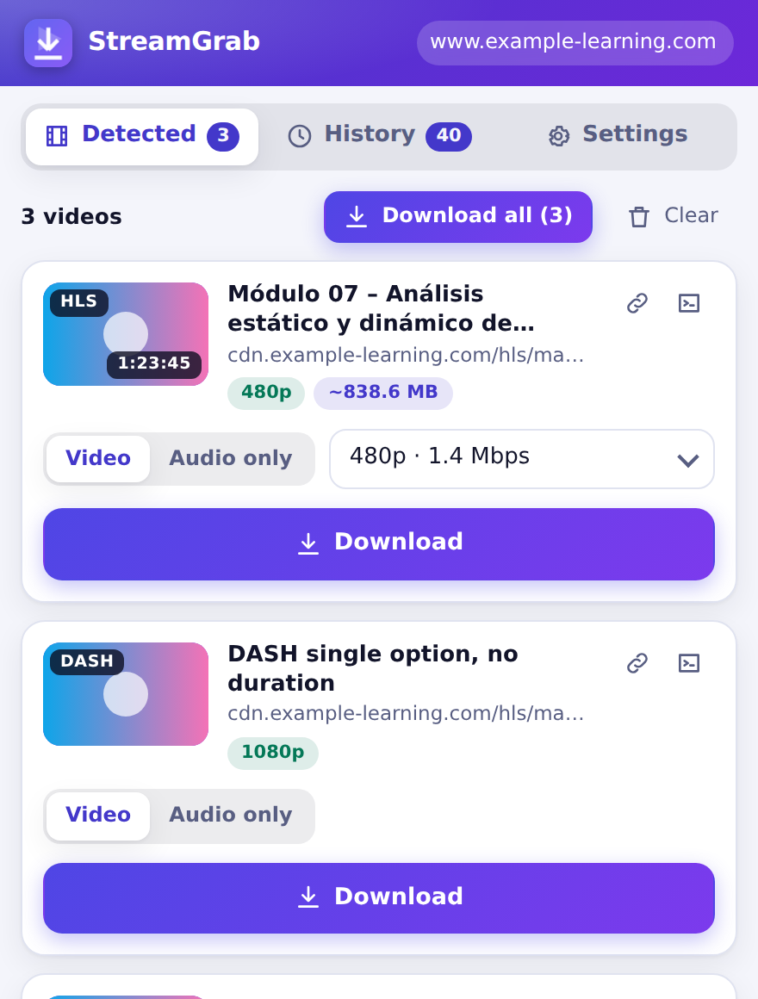
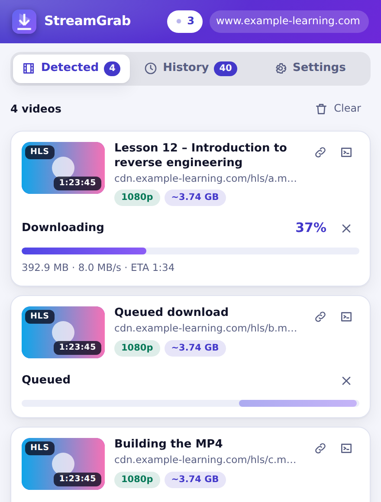
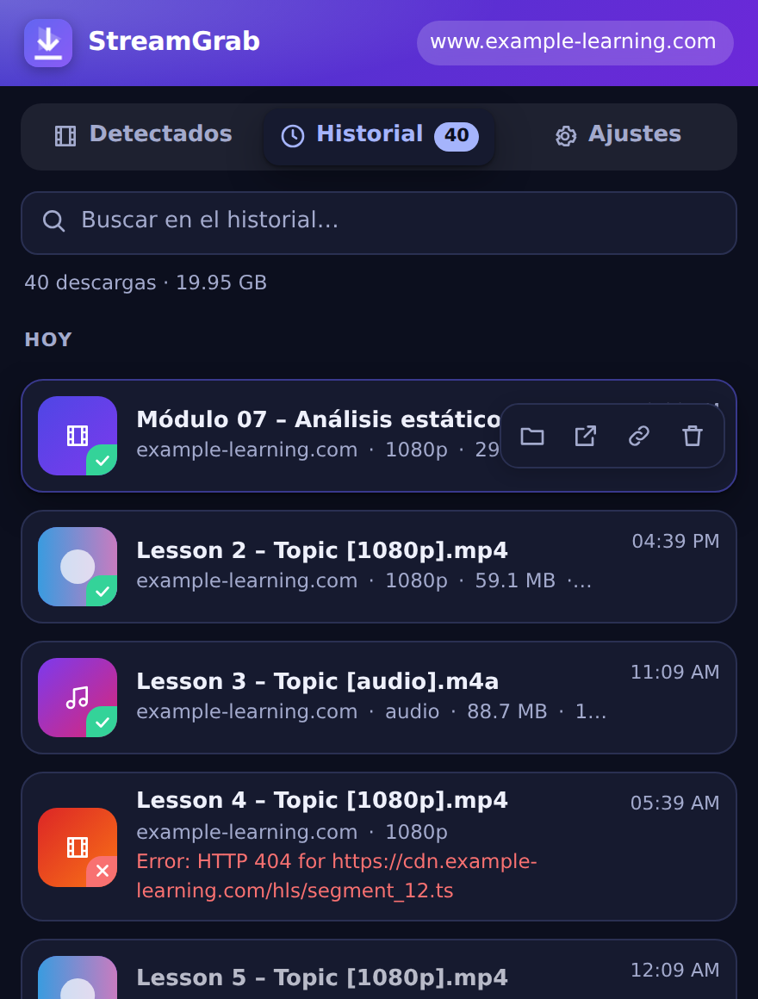
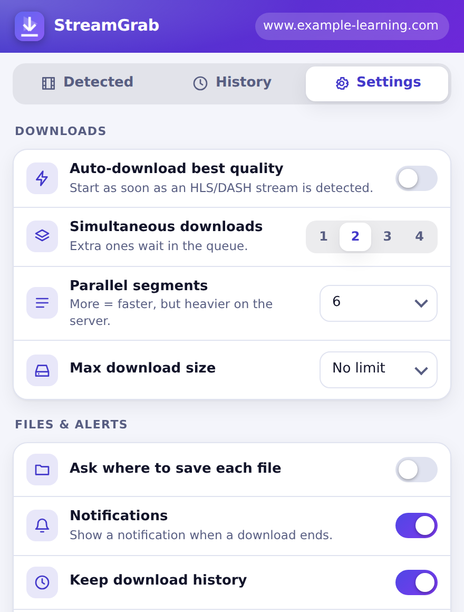
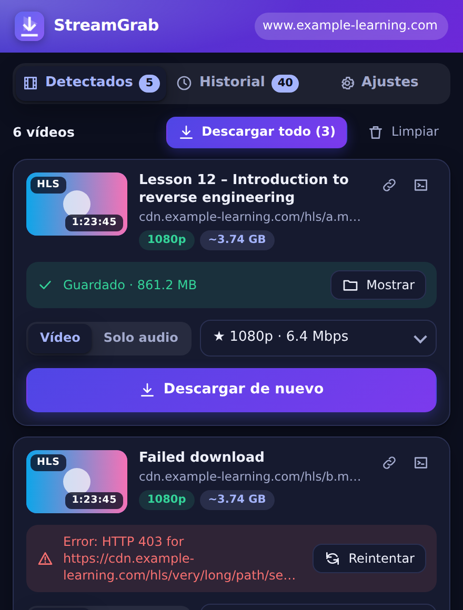
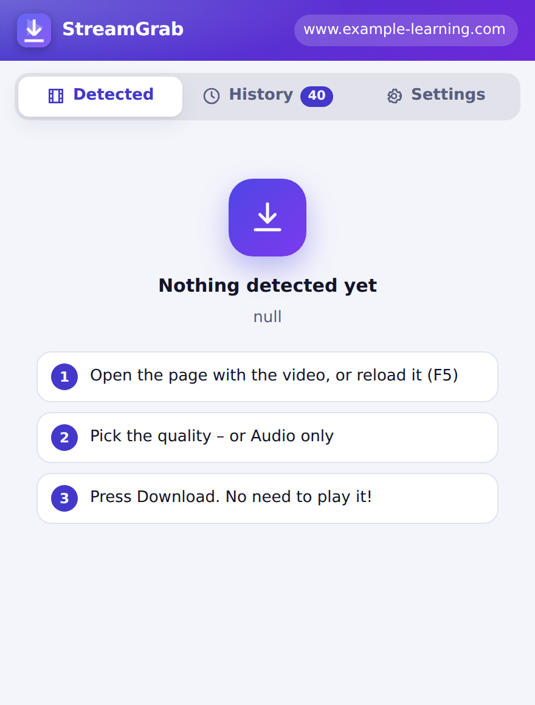

<div align="center">


# StreamGrab

**Download HLS, DASH and `blob:` videos as a single, seekable MP4 – without playing them.**

Chrome · Edge · Brave · Opera · Vivaldi · Firefox &nbsp;|&nbsp; Manifest V3 &nbsp;|&nbsp; No servers, no tracking &nbsp;|&nbsp; MIT

[](https://github.com/YOUR_USER/streamgrab/actions)
 

  

</div>

> *Español: ve a [Guía rápida en español](#guía-rápida-en-español).*

## Why

Many sites play video through a `blob:` URL (MediaSource / hls.js / dash.js / Video.js). "Save video as…" does nothing there.
The `blob:` is only the player's output – the real source is a **manifest** (`.m3u8` / `.mpd`) the page fetched.
StreamGrab watches those requests, reads the manifest, downloads the segments itself and rebuilds **one MP4 with audio and video**
at the quality you choose. **You don't have to watch the video**: open or reload the page, pick it, download (or enable auto-download).

## Features

| | |
|---|---|
| 🎯 **Detection** | HLS `.m3u8`, DASH `.mpd`, progressive `.mp4/.webm`, and manifests with no extension / generic content-type (sniffed from the page's `fetch`/XHR). Variant playlists are hidden behind their master. |
| 🎞️ **Quality picker** | Every rendition with resolution + bitrate, estimated size and duration. |
| 🔊 **Audio only (M4A)** | One click; for streams with a separate audio rendition the video segments are **never downloaded**. |
| 📦 **Clean MP4** | Regular "faststart" MP4 (not fragmented): shows duration, seeks everywhere, A/V in sync (edit lists), no re-encoding. |
| 🔐 **AES-128 HLS** | Decrypted with WebCrypto. (DRM is never bypassed – detected and reported.) |
| 🍪 **Hotlink-protected CDNs** | Referer/Origin emulated with `declarativeNetRequest`; your cookies are sent. |
| ⏱️ **Live progress** | %, size, speed and ETA; cancel any time. |
| 🧵 **Queue** | N simultaneous downloads (1–4), the rest wait. **Download all** button. |
| 🕘 **History** | Searchable, grouped by day, "show in folder", open source page, copy URL, export JSON. Flags files deleted from disk. |
| 🔔 **Notifications** | When a download finishes or fails (click → show file). |
| 🏷️ **File name template** | `{title} [{quality}]`, `{site}`, `{date}`, `{time}` with live preview. |
| 🖼️ **Thumbnails** | Page poster / `og:image` on each card. |
| 📋 **Copy helpers** | Copy the stream URL or a ready-to-run `ffmpeg -referer … -i … -c copy` command. |
| 🤖 **Auto-download** | Reload the page and the best quality starts downloading by itself. |
| 🌗 **Themes & languages** | Light / dark / system · English & Español. |
| ♾️ **No artificial limits** | Hours-long videos (tested: 1 h = 108 000 frames), >4 GB via 64-bit MP4 offsets; optional size cap. |

## Design
<div align="center">
  
</div>

Light/dark/system themes, English & Español, AA-contrast palette, keyboard-focus rings, reduced-motion support. Every screen is audited automatically
(`npm run test:gallery`: overflow, clipped text, tap targets, WCAG contrast, in 4 theme×language combinations).

## Supported sources

| Source | Status |
|---|---|
| HLS MPEG-TS (H.264/AAC) | ✅ |
| HLS fMP4/CMAF, separate audio renditions | ✅ |
| HLS AES-128 | ✅ |
| DASH fMP4 (SegmentTemplate / Timeline / List / Base) | ✅ |
| Progressive MP4/WebM | ✅ (browser downloader) |
| DRM (Widevine / PlayReady / FairPlay / SAMPLE-AES) | ❌ never |
| Live streams | ⚠️ downloads what is listed now |
| DASH WebM/VP9, HEVC-in-TS, packed-AAC HLS audio | ❌ not yet |

## Install

### From source (dev)
```bash
git clone https://github.com/YOUR_USER/streamgrab && cd streamgrab
npm ci && npm run build
```
* **Chrome / Edge / Brave / Opera / Vivaldi** → `chrome://extensions` → *Developer mode* → *Load unpacked* → `dist/chrome`
* **Firefox ≥ 140** → `about:debugging#/runtime/this-firefox` → *Load Temporary Add-on* → `dist/firefox/manifest.json`
* Release ZIPs: `npm run pack` → `dist/streamgrab-chrome-v*.zip`, `dist/streamgrab-firefox-v*.zip` (also attached to every GitHub Release).

## Guía rápida en español
1. Abre la página con el vídeo o **recárgala (F5)**: la extensión solo ve las peticiones mientras está activa.
2. El icono muestra un contador. Abre el popup → pestaña **Detectados** → elige calidad (o **Solo audio**) → **Descargar**.
3. **Historial**: todo lo descargado, con búsqueda, "mostrar en carpeta", abrir página y exportar.
4. **Ajustes**: descarga automática, descargas simultáneas, límite de tamaño, plantilla de nombre, tema, idioma, notificaciones.

## Usage tips
* Nothing detected? Reload the page (F5). Pages opened *before* installing the extension must be reloaded once.
* Several items? Use **Download all** or pick each quality. Extra downloads wait in the queue.
* Name template examples: `{site} - {title} [{quality}]`, `{date} {title}`.
* Need it in a script? Use the *copy ffmpeg command* button.

## Development
```bash
npm run fixtures        # ffmpeg generates HLS-TS, AES-128, HLS-fMP4+audio, DASH test streams
npm run fixtures:long   # 1-hour HLS (108k frames) for scale regressions
npm test                # engine tests: ffprobe + full ffmpeg decode + frame counts + A/V sync
npm run test:gallery    # design audit of every popup state (light/dark × en/es)
npm run test:ui         # real-click tab switching regression
npm run test:e2e        # real Chromium + built extension (set CHROME_BIN, see CONTRIBUTING)
npm run lint:firefox    # web-ext lint: 0 errors / 0 warnings required
npm run screenshots     # re-generates docs/screenshots via the e2e run
npm run check           # everything
```
Architecture and design decisions: [docs/ARCHITECTURE.md](docs/ARCHITECTURE.md). Full re-implementation spec for AI agents: [docs/AGENT_PROMPT.md](docs/AGENT_PROMPT.md).

## Privacy & safety
No analytics, no remote servers, no data leaves your machine except the requests to the video's own host. See [PRIVACY.md](PRIVACY.md) and [SECURITY.md](SECURITY.md).
**Use it only on content you have the right to download.** StreamGrab does not and will not circumvent DRM.

## Known limitations
* Size: no built-in limit (optional cap in Settings). Segments are kept as browser Blobs (disk-backed); multi-GB files were validated at the MP4-layout level (`co64`), not end-to-end.
* Sites that stream through MSE with **no fetchable manifest** (custom binary protocols) can't be reconstructed.
* Firefox: build + `web-ext lint` verified; the automated browser e2e runs on Chromium only.
* Firefox event pages can be suspended: very long downloads are most reliable on Chromium browsers.

## Contributing
PRs welcome – see [CONTRIBUTING.md](CONTRIBUTING.md). Roadmap ideas: subtitles (WebVTT), WebM/VP9 DASH, packed-AAC HLS, SAMPLE-AES-free fMP4 live capture, per-site rules.

## License
[MIT](LICENSE)
